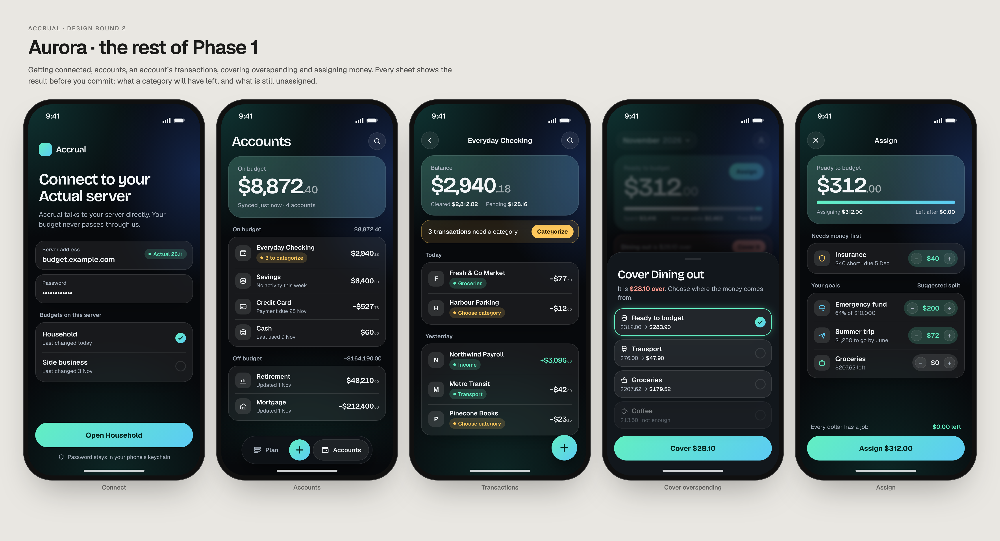

# Design

Mockups for Accrual's phone UI. Everything here is drawn with made-up data
([`src/data.mjs`](src/data.mjs)); nothing comes from a real budget.

## Direction: Aurora

Chosen on 19 November 2026, from the three directions in round 1 below. Dark first, frosted-glass
tiles two to a row, and colour for state: mint is funded, blue is a savings goal, amber needs
money, coral is overspent, grey is spent as planned.

## Round 2: Aurora, the rest of Phase 1

**Status:** drawn, waiting for review. None of it is built.



- **Connect.** Server address, password and the budgets on that server, on one screen.
- **Accounts.** On-budget total first; an account with transactions waiting shows how many.
- **Transactions.** Uncategorized items are marked in amber in the list, with one button to
  work through them.
- **Cover overspending.** A sheet over the Plan. Each source shows what it would have left, and
  one that cannot cover the amount is greyed out.
- **Assign.** Categories short of a target come first. The total left updates as you go.

### Aurora under stress


These are the cases round 1 left unchecked.

| Case | What was done |
|---|---|
| Android | Drawn in an Android frame with solid tiles. The frosted effect needs live blur, which is costly on mid-range Android phones, so tiles get a flat colour there and keep the same layout. |
| Largest text size | The grid drops to one column, with the amount beside the name. Nothing is cut off. |
| Long names | Names wrap to two lines, then end in an ellipsis. Amounts of $1,000 or more drop one size. |
| Bad news | Overbudgeted (To Budget below zero) turns the top card coral with a Fix button. Being offline shows in place of the profile button. |
| Contrast | Seven round 1 colours failed WCAG AA for small text. All were changed and now pass (table below). |

**Contrast, worst case on a tile.** Small text needs 4.5:1. Run `node design/src/contrast.mjs`
to check; it fails if any colour drops below that.

| Colour | Dark, round 1 | Dark, now | Light, round 1 | Light, now |
|---|---|---|---|---|
| Body text | 9.32 | 10.48 | 17.69 | 17.69 |
| Grey notes | 3.45 | 5.36 | 4.61 | 5.57 |
| Funded (mint) | 7.05 | 7.93 | 2.99 | 5.07 |
| Goal (blue) | 5.12 | 6.12 | 3.87 | 5.43 |
| Needs money (amber) | 6.63 | 7.46 | 3.42 | 5.46 |
| Overspent (coral) | 4.10 | 5.56 | 4.17 | 5.33 |
| Spent (grey) | 2.32 | 4.95 | 2.86 | 4.60 |

The dark figures improved partly because the green glow behind the tiles was made darker.

### Still open after round 2

- **The contrast check covers text on tiles only.** Text on the top card's gradient, on the
  coral and amber notices and on buttons has not been measured.
- **Large text is drawn for the Plan screen only**, and only on iPhone. No screen-reader order or
  labels have been worked out.
- **Android is one screen.** Back navigation, the system keyboard and Material conventions for
  sheets are not drawn.
- **Not drawn at all:** moving money between two categories, working through uncategorized
  transactions, editing a transaction, split transactions, search, settings, empty states
  (a new budget, a month with nothing budgeted), and sync errors.
- **No motion.** How tiles, sheets and the top card animate is undecided.
- **No brand.** The mint square beside "Accrual" is a placeholder, not a logo.

## Round 1: three directions

**Status:** closed. B · Aurora was chosen. A and C are kept here as a record.

The same three screens in each direction, on the same fake household, so they can be compared
like for like: the **Plan** screen (the month's budget), a **Category** screen, and **Quick add**
for a transaction. Each board also shows Plan in the other colour scheme.

### A · Ledger


Paper, ink and serif figures. No cards: each category is a line on a page and the rule under it
is its progress bar. The calmest of the three, and the closest to "a private bank's statement".

- **For it:** the most restrained and the hardest to mistake for another finance app. Type does
  the work, so it costs little to draw and animates cheaply on any phone.
- **Against it:** the 2-pixel bars are the quietest progress signal of the three, so a month in
  trouble does not stand out much. A serif for figures is a strong taste; some will find it
  old-fashioned.

### B · Aurora


Dark first, frosted-glass tiles over a slow gradient, two categories to a row. Colour carries
the state: mint is funded, amber needs money, coral is overspent.

- **For it:** the densest (two categories per row) and the most "native 2026" look. State is
  readable from colour alone.
- **Against it:** the least original. Dark glass with a mint gradient is where most finance apps
  already are. Real-time blur is expensive on mid-range Android phones, and a two-column grid
  truncates long category names.

### C · Meter


Every row is a fuel gauge: the card fills with what is left and drains as you spend. Black,
white and one lime, with vermilion only when something is wrong. A hatched section shows money
a target still needs.

- **For it:** the fastest to read. One glance down the screen shows how full every category is,
  with no separate bar to look for. The same gauge is reused everywhere: the category screen
  marks where an even pace would be, and Quick add shows the bite a purchase takes before you
  save it. It is the one idea here another app does not already have.
- **Against it:** the loudest. Lime on black is a strong brand statement and less "calm" than
  the README promises. Text sits on top of a coloured fill, so contrast needs care.

### Recommendation at the time

Not followed: Aurora was chosen instead. Kept for the reasoning.

**Build on C · Meter's structure, and decide the tone separately.** The row-as-gauge is the part
worth owning: it is what makes the Plan screen readable in a second, which is the job the
official app's three-column table does worst. Its colour and type are a separate choice. If lime
feels too loud, the same structure works in Ledger's paper, ink and evergreen, and round 2 can
show that side by side.

## What the designs were planned from

- **The official app.** Upstream's mobile app (v26.11.0, a WebView around the web app) was built
  from source and run against the test server. Its budget screen stacks three warning banners
  and then shows three number columns per category; adding a transaction is a web form with a
  custom keypad. Each direction answers those screens directly: one number per category, one
  notice, and the amount first when adding.
- **[`docs/plan.md`](../docs/plan.md).** The Phase 1 screens: month switcher, To Budget, category
  groups, cards with progress and a single "Available" figure, a target status, covering
  overspending, quick add.
- **[`docs/business.md`](../docs/business.md).** The bar is "obviously better than the official
  app within the first minute".
- **How Actual works.** The figures shown are ones the engine already provides for each
  category: budgeted, spent and balance, plus To Budget for the month.

## Assumptions

- **Target labels** ("$40 needed by 5 Dec", "64% of $10,000") rely on Actual's goal templates,
  which are an experimental feature a user has to turn on. Categories without one would show a
  plainer label. How common templates are among real users has not been checked.
- **Pace** ("$17.30 a day") is our own sum from balance and days left. It is not an Actual
  feature.
- **Fonts** are loaded from Google Fonts when a board is opened (Bricolage Grotesque and Geist
  for Aurora; all under the Open Font License). None is bundled yet.

## Rebuilding

Node 20+, no dependencies. Needs Chrome for the PNGs.

```sh
node design/src/build.mjs              # writes design/boards/<round>/*.html (gitignored)
node design/src/export.mjs round-2     # renders a round to design/previews/round-2/*.png
node design/src/contrast.mjs           # checks Aurora's colours against WCAG AA
```

Open a board in a browser to see it at full size: `open design/boards/round-2/aurora-screens.html`.

| Path | Contents |
|---|---|
| `src/data.mjs` | The fake household every direction draws |
| `src/lib.mjs` | Phone frame, icons, money formatting, page shell |
| `src/ledger.mjs`, `src/aurora.mjs`, `src/meter.mjs` | One direction each: its styles and three screens |
| `src/aurora2.mjs` | Aurora's round 2 styles and corrected colours |
| `src/aurora-screens.mjs`, `src/aurora-checks.mjs` | The two round 2 boards |
| `src/contrast.mjs` | The contrast check |
| `previews/` | PNG exports, one folder per round |
