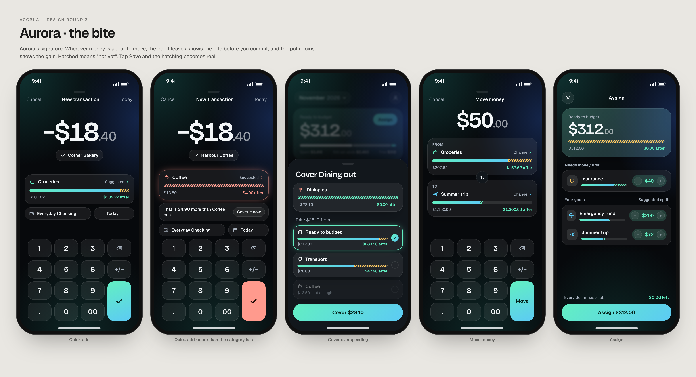
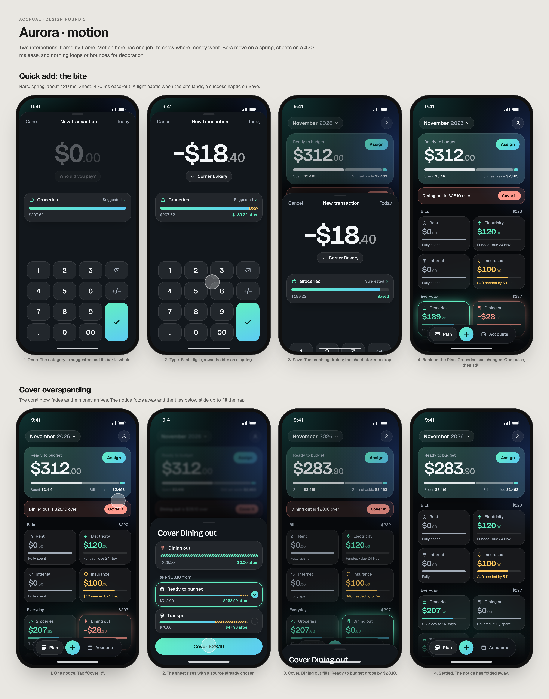
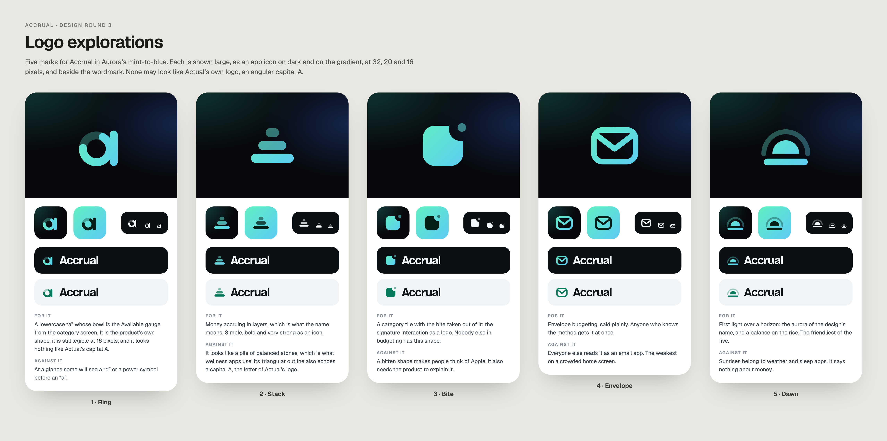
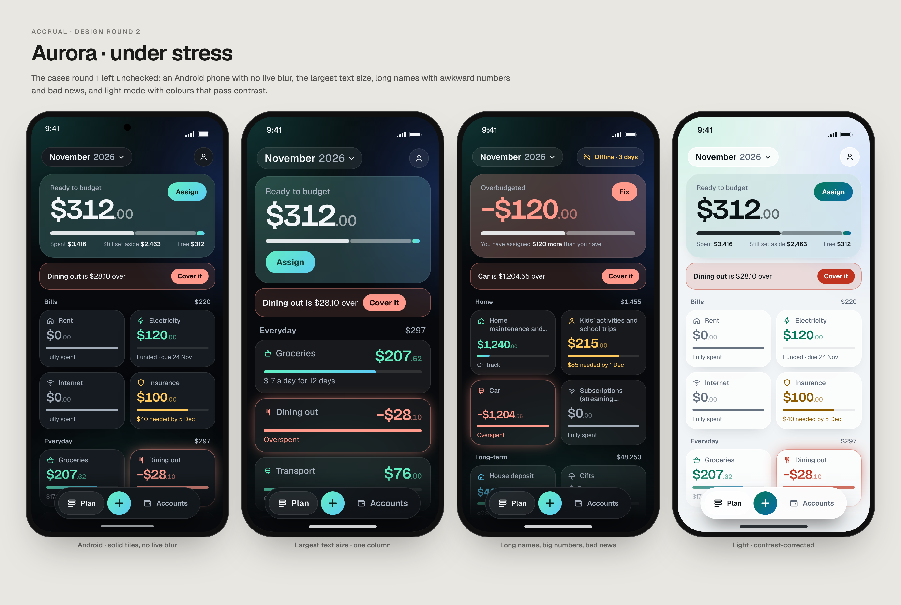
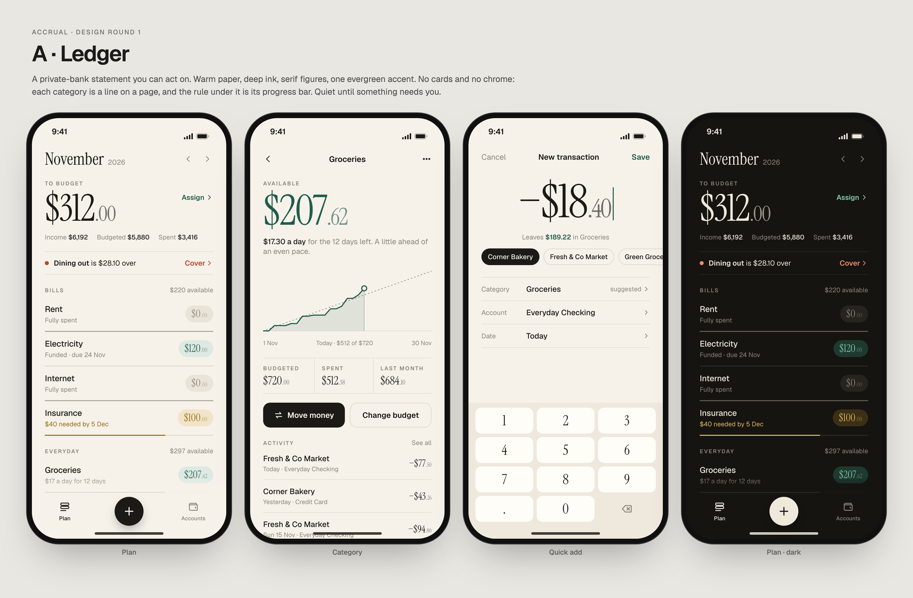
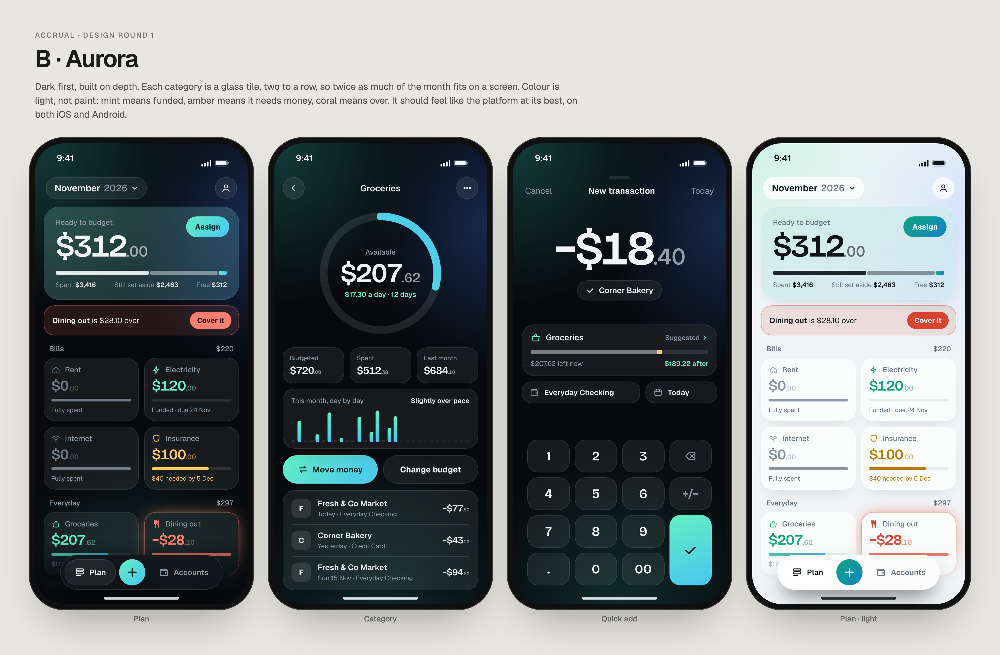
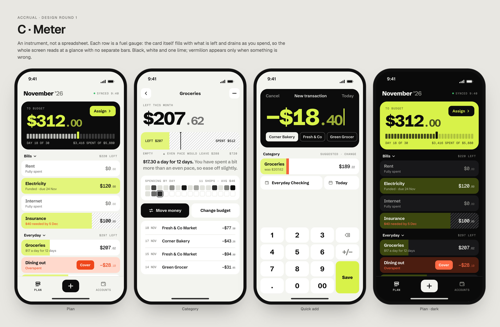

# Design

Mockups for Accrual's phone UI. Everything here is drawn with made-up data
([`src/data.mjs`](src/data.mjs)); nothing comes from a real budget.

## Direction: Aurora

Chosen on 19 November 2026, from the three directions in round 1 below. Dark first, frosted-glass
tiles two to a row, and colour for state: mint is funded, blue is a savings goal, amber needs
money, coral is overspent, grey is spent as planned.

### Where the built Plan screen differs, on purpose

Plan 2 built the Plan screen from round 1 B. It leaves out three things the mockups show:

- **No icons on the tiles.** Actual stores no icon for a category, so there is nothing to show.
  Anyone who wants one can put an emoji in the category's name, and it shows as part of the name.
- **No Assign button on the top card and no Cover it button on the notice, yet.** Both arrive
  with plan 4 (moving money). Until then the top card and the notice only inform: a button that
  does nothing is worse than no button.
- **No dock (Plan, +, Accounts) yet.** Quick add comes in plan 3 and Accounts in plan 5. The dock
  appears when there is a second place to go.

## Round 3: the bite, motion and a logo

**Status:** reviewed and accepted on 19 November 2026. The logo is 1 · Ring; its files are in
[`brand/`](brand/README.md). The bite is built for quick add (plan 3) and for moving, covering and
assigning (plan 4), both below; the motion spec and the logo are not built yet.

### The bite



Aurora's signature, borrowed from the Meter direction. Wherever money is about to move, the pot
it leaves shows the bite before you commit, and the pot it joins shows the gain. Solid means it
has happened; hatched means it has not happened yet.

| Sheet | What the bite shows |
|---|---|
| Quick add | What the category will have left after this purchase |
| Quick add, too much | The whole bar turns coral, says how far over it goes, and offers to cover it on the spot |
| Cover overspending | The deficit filling in, and the bite each possible source would take |
| Move money | A bite from one category and the matching gain in the other |
| Assign | Ready to budget emptying, and each category's gain towards its target |

The bar's full width is always the pot as it is now, so a small purchase from a big category is
a small bite. A bite is never drawn narrower than 4% of the bar, so it stays visible.

**Built in plan 3 (quick add), with three things left out on purpose:**

- **No "Cover it now".** When a purchase is more than the category has, the sheet turns the bar
  coral and says by how much, but offers no button. Covering needs the Cover sheet, which comes
  with plan 4; until then a button there would lead nowhere.
- **No calendar.** The date steps back a day at a time from Today and never goes past it. A
  calendar picker would need a new native package, which waits until one is clearly needed.
- **No haptics, and only the bite moves.** The bite's split springs as digits are typed;
  everything else waits for the motion spec and haptics in plan 6.

The built sheet also differs from the board in two smaller ways: the date sits next to the
account rather than at the top right of the header, and the payee is a field rather than a
pill under the amount.

**Built in plan 4 (moving money), differing from the board on purpose:**

- **One sheet moves and assigns.** The board has a Move money sheet and a separate Assign screen.
  The app has one: *From*, *To* and an amount, where a pot is a category or Ready to budget.
  Assigning is a move from Ready to budget, un-assigning a move to it, and fixing an overbudgeted
  month (the top card's `Fix`) a move to it with the shortfall filled in. One sheet means one set
  of rules for what can move, and Actual's own actions for assigning are moves between a category
  and Ready to budget anyway.
- **No suggested split.** The board's Assign spreads Ready to budget across goals ("Needs money
  first", "Your goals", with steppers). That needs goal templates, which most budgets do not have,
  so assigning is to one category at a time.
- **A source that is not enough can still be chosen.** On the board's Cover sheet a pot that
  cannot cover the whole amount is greyed out ("not enough"). In the app it stays choosable, says
  "not enough for all of it", and the button then reads "Cover $59.45 of $298.80": covering part
  of an overspend is still useful, and when the deficit is bigger than every pot it is the only
  way to cover any of it. Ready to budget is chosen first when it can cover everything; otherwise
  the first category, in the Plan's order, that can; otherwise the pot with the most.
- **Covering is a full sheet**, not a half sheet over the dimmed Plan: it lists every pot that
  could pay, which does not fit in half a screen. It has no keypad, because the amount is known.
- **The move sheet's keypad has no `+/−`**, so the key under delete is empty. A move's direction
  is From and To, and the swap control between the cards changes it.
- **Past months are read-only.** A category's screen opens for any month, but nothing can be
  moved, covered or assigned before the current month: that changes every month after it.
- **A move cannot take more than the *from* pot has.** The bar turns coral, a line says by how
  much, and the button is off, as in quick add. Actual itself would let a category go negative
  this way; on a phone that should not be one tap.

### Motion



Two interactions as storyboards. To see them move, open
[the live board](https://htmlpreview.github.io/?https://github.com/Longarm-Software/accrual/blob/main/design/previews/round-3/aurora-motion-live.html)
(or `open design/previews/round-3/aurora-motion-live.html` in a clone). That version is a timing sketch: numbers
switch instead of rolling, and a browser has no haptics.

Motion has one job here, which is to show where money went.

| What moves | How | Why |
|---|---|---|
| Bars (bites, gains, progress) | Spring, about 420 ms, slight overshoot | Money arriving should feel like it has weight |
| Sheets | 420 ms, ease-out | Fast to respond, gentle to land |
| Colour, glow, opacity | 240 ms, ease-out | State changes should not draw the eye twice |
| Press feedback | 120 ms | Has to feel instant |
| Amounts | Roll to the new value over 240 ms | A number that just switches looks like a glitch |

- **Haptics:** light when a bite lands, success on Save, Cover and Assign, warning when a bite
  goes past what the category has.
- **Reduce Motion:** when the system setting is on, sheets fade instead of sliding, bars and
  amounts go straight to their new value, and nothing pulses.
- **Not decided:** the first load of the Plan, changing month, pull to refresh, and anything on
  the Accounts and Transactions screens.

These timings are proposals. None has been tried on a phone.

### Logo



Five marks. **Chosen: 1 · Ring**, a lowercase "a" whose bowl is the Available gauge. It is
the only one that is both the product's own shape and the name's initial, and it does not
resemble Actual's logo. Bite is the runner-up, and the better choice if the bite becomes what
people remember the app for.

Before any of these is used: nobody has searched for similar existing logos or trademarks, and
the name itself is still unchecked (see [`docs/business.md`](../docs/business.md)). The wordmark
is set in Bricolage Grotesque as a stand-in; its lettering has not been drawn.

## Round 2: Aurora, the rest of Phase 1

**Status:** reviewed and accepted on 19 November 2026. None of it is built.


- **Connect.** Server address, password and the budgets on that server, on one screen.
- **Accounts.** On-budget total first; an account with transactions waiting shows how many.
- **Transactions.** Uncategorized items are marked in amber in the list, with one button to
  work through them.
- **Cover overspending.** A sheet over the Plan. Each source shows what it would have left, and
  one that cannot cover the amount is greyed out.
- **Assign.** Categories short of a target come first. The total left updates as you go.

### Aurora under stress



These are the cases round 1 left unchecked.

| Case | What was done |
|---|---|
| Android | Drawn in an Android frame with solid tiles. The frosted effect needs live blur, which is costly on mid-range Android phones, so tiles get a flat colour there and keep the same layout. |
| Largest text size | The grid drops to one column, with the amount beside the name. Nothing is cut off. |
| Long names | Names wrap to two lines, then end in an ellipsis. Amounts of $1,000 or more drop one size. |
| Bad news | Overbudgeted (To Budget below zero) turns the top card coral with a Fix button. Being offline shows in place of the profile button. |
| Contrast | Seven round 1 colours failed WCAG AA for small text. All were changed and now pass (table below). |

**Contrast, worst case on a tile.** Small text needs 4.5:1. Run `node design/src/contrast.mjs`
to check; it fails if any colour drops below that.

| Colour | Dark, round 1 | Dark, now | Light, round 1 | Light, now |
|---|---|---|---|---|
| Body text | 9.32 | 10.48 | 17.69 | 17.69 |
| Grey notes | 3.45 | 5.36 | 4.61 | 5.57 |
| Funded (mint) | 7.05 | 7.93 | 2.99 | 5.07 |
| Goal (blue) | 5.12 | 6.12 | 3.87 | 5.43 |
| Needs money (amber) | 6.63 | 7.46 | 3.42 | 5.46 |
| Overspent (coral) | 4.10 | 5.56 | 4.17 | 5.33 |
| Spent (grey) | 2.32 | 4.95 | 2.86 | 4.60 |

The dark figures improved partly because the green glow behind the tiles was made darker.

### Still open after round 2

- **The contrast check covers text on tiles only.** Text on the top card's gradient, on the
  coral and amber notices and on buttons has not been measured.
- **Large text is drawn for the Plan screen only**, and only on iPhone. No screen-reader order or
  labels have been worked out.
- **Android is one screen.** Back navigation, the system keyboard and Material conventions for
  sheets are not drawn.
- **Not drawn at all:** moving money between two categories, working through uncategorized
  transactions, editing a transaction, split transactions, search, settings, empty states
  (a new budget, a month with nothing budgeted), and sync errors.
- **Motion and a logo** were open here and are taken up in round 3.

## Round 1: three directions

**Status:** closed. B · Aurora was chosen. A and C are kept here as a record.

The same three screens in each direction, on the same fake household, so they can be compared
like for like: the **Plan** screen (the month's budget), a **Category** screen, and **Quick add**
for a transaction. Each board also shows Plan in the other colour scheme.

### A · Ledger



Paper, ink and serif figures. No cards: each category is a line on a page and the rule under it
is its progress bar. The calmest of the three, and the closest to "a private bank's statement".

- **For it:** the most restrained and the hardest to mistake for another finance app. Type does
  the work, so it costs little to draw and animates cheaply on any phone.
- **Against it:** the 2-pixel bars are the quietest progress signal of the three, so a month in
  trouble does not stand out much. A serif for figures is a strong taste; some will find it
  old-fashioned.

### B · Aurora



Dark first, frosted-glass tiles over a slow gradient, two categories to a row. Colour carries
the state: mint is funded, amber needs money, coral is overspent.

- **For it:** the densest (two categories per row) and the most "native 2026" look. State is
  readable from colour alone.
- **Against it:** the least original. Dark glass with a mint gradient is where most finance apps
  already are. Real-time blur is expensive on mid-range Android phones, and a two-column grid
  truncates long category names.

### C · Meter



Every row is a fuel gauge: the card fills with what is left and drains as you spend. Black,
white and one lime, with vermilion only when something is wrong. A hatched section shows money
a target still needs.

- **For it:** the fastest to read. One glance down the screen shows how full every category is,
  with no separate bar to look for. The same gauge is reused everywhere: the category screen
  marks where an even pace would be, and Quick add shows the bite a purchase takes before you
  save it. It is the one idea here another app does not already have.
- **Against it:** the loudest. Lime on black is a strong brand statement and less "calm" than
  the README promises. Text sits on top of a coloured fill, so contrast needs care.

### Recommendation at the time

Not followed: Aurora was chosen instead. Kept for the reasoning.

**Build on C · Meter's structure, and decide the tone separately.** The row-as-gauge is the part
worth owning: it is what makes the Plan screen readable in a second, which is the job the
official app's three-column table does worst. Its colour and type are a separate choice. If lime
feels too loud, the same structure works in Ledger's paper, ink and evergreen, and round 2 can
show that side by side.

## What the designs were planned from

- **The official app.** Upstream's mobile app (v26.11.0, a WebView around the web app) was built
  from source and run against the test server. Its budget screen stacks three warning banners
  and then shows three number columns per category; adding a transaction is a web form with a
  custom keypad. Each direction answers those screens directly: one number per category, one
  notice, and the amount first when adding.
- **[`docs/plan.md`](../docs/plan.md).** The Phase 1 screens: month switcher, To Budget, category
  groups, cards with progress and a single "Available" figure, a target status, covering
  overspending, quick add.
- **[`docs/business.md`](../docs/business.md).** The bar is "obviously better than the official
  app within the first minute".
- **How Actual works.** The figures shown are ones the engine already provides for each
  category: budgeted, spent and balance, plus To Budget for the month.

## Assumptions

- **Target labels** ("$40 needed by 5 Dec", "64% of $10,000") rely on Actual's goal templates,
  which are an experimental feature a user has to turn on. Categories without one would show a
  plainer label. How common templates are among real users has not been checked.
- **Pace** ("$17.30 a day") is our own sum from balance and days left. It is not an Actual
  feature.
- **Fonts** are loaded from Google Fonts when a board is opened (Bricolage Grotesque and Geist
  for Aurora; all under the Open Font License). None is bundled yet.

## Rebuilding

Node 20+, no dependencies. Needs Chrome for the PNGs.

```sh
node design/src/build.mjs              # writes design/boards/<round>/*.html (gitignored)
node design/src/export.mjs round-3     # renders a round to design/previews/round-3/*.png
node design/src/contrast.mjs           # checks Aurora's colours against WCAG AA
```

Open a board in a browser to see it at full size: `open design/boards/round-3/aurora-bite.html`.

| Path | Contents |
|---|---|
| `src/data.mjs` | The fake household every direction draws |
| `src/lib.mjs` | Phone frame, icons, money formatting, page shell |
| `src/ledger.mjs`, `src/aurora.mjs`, `src/meter.mjs` | One direction each: its styles and three screens |
| `src/aurora2.mjs` | Aurora's round 2 styles and corrected colours |
| `src/aurora-screens.mjs`, `src/aurora-checks.mjs` | The two round 2 boards |
| `src/aurora3.mjs` | The bite component |
| `src/aurora-bite.mjs`, `src/aurora-motion.mjs`, `src/aurora-motion-live.mjs`, `src/aurora-logo.mjs` | The round 3 boards; the live one is for a browser and has no PNG |
| `src/contrast.mjs` | The contrast check |
| `previews/` | PNG exports, one folder per round |
| `brand/` | The logo and app icon, written by `src/brand.mjs` |
